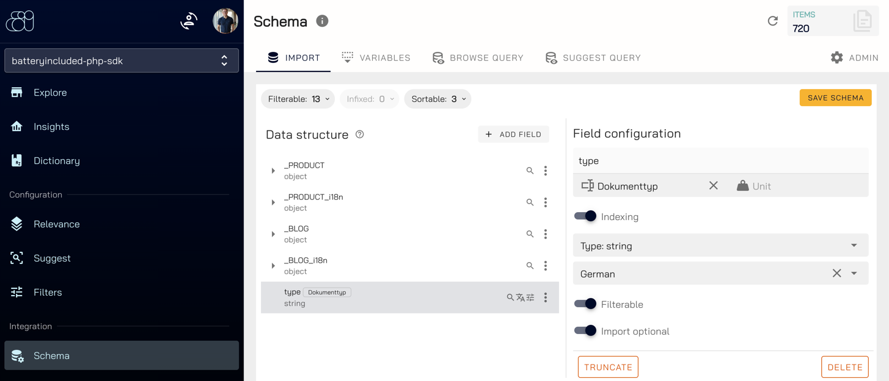
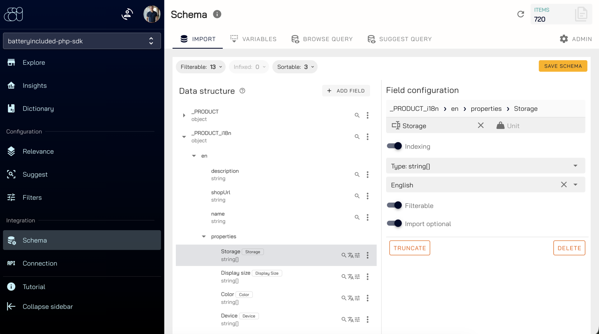
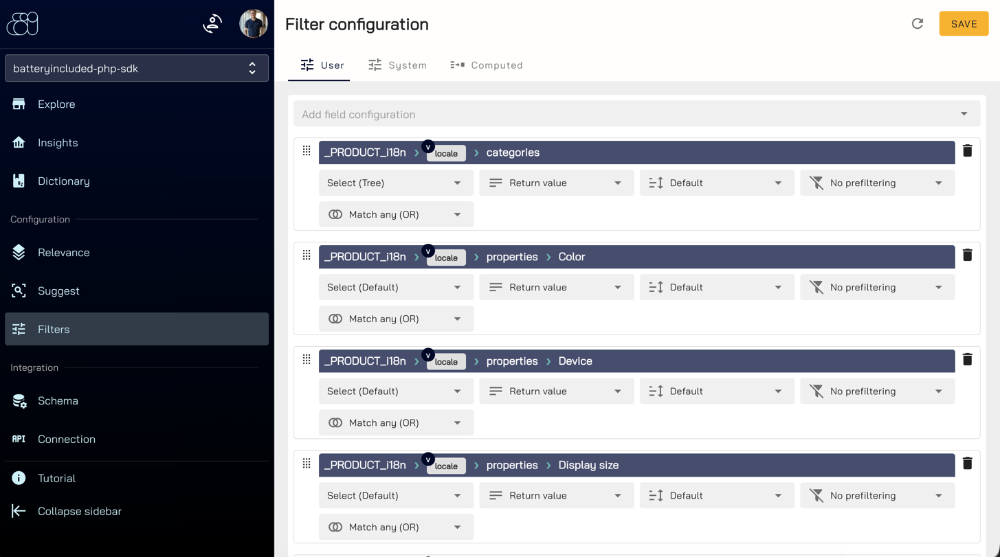
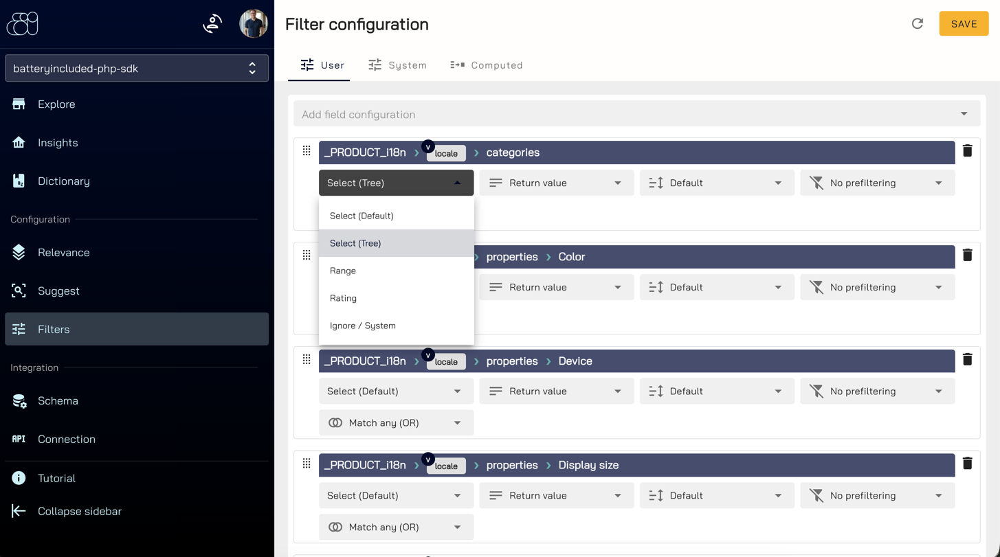
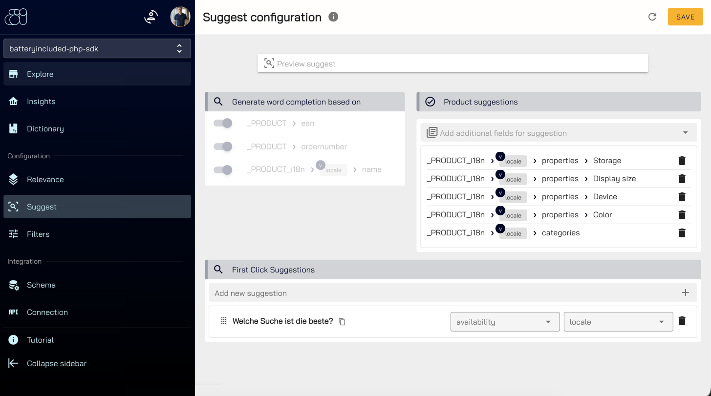
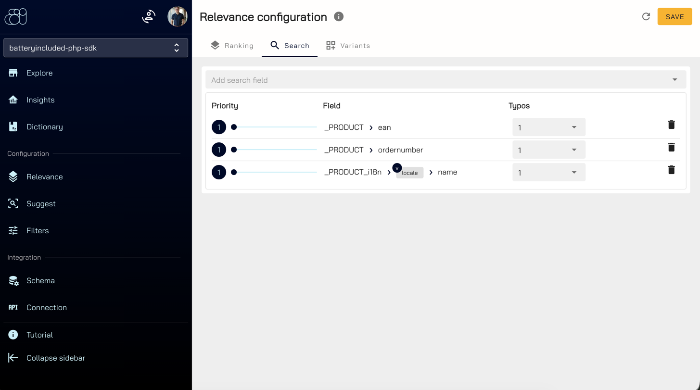

# Backend configuration
{: .no_toc }

1. TOC
{:toc}

The SDK sends documents and reads results, but **how** they are searched is configured in the
[BatteryIncluded portal](https://portal.batteryincluded.io): which fields can be filtered, which fields feed the
suggestions and how relevant each field is for the search.

| Area | Menu | What you configure | Effect in the SDK |
|---|---|---|---|
| [Schema](#schema) | Integration → Schema | Field is filterable, language, label, unit | Field can become a filter, `FacetDto::getFieldLabel()`, `getFieldUnit()` |
| [Filters](#filters) | Configuration → Filters | Filters shown in the result and their type | `BrowseResponse::getFacets()` |
| [Suggest](#suggest) | Configuration → Suggest | Fields for completions and suggested documents | `SuggestResponse` |
| [Relevance](#relevance) | Configuration → Relevance | Searched fields, their priority and typo tolerance | Hits and their order in `BrowseResponse::getHits()` |

{: .important }
Configure the portal after the first sync. It can only offer fields that already exist in your documents. Every page
has its own **Save** button, changes are not applied before you save.

## Schema

**Integration → Schema** shows the data structure of your documents. A field has to be marked as **Filterable**
before it can be configured as filter.



1. Open the field in the **Data structure** tree, e.g. `type`.
2. In the **Field configuration** on the right:
   - enter the **label** shown in your shop, e.g. "Dokumenttyp", and for numeric fields the **Unit** (e.g. `€`),
   - choose the **language** of the field,
   - enable **Filterable**.
3. Click **Save schema**.

The counters above the tree (**Filterable**, **Sortable**) show how many fields are enabled.

### Translated fields

With [translations](translations) every locale has its own fields below `_PRODUCT_i18n`, e.g.
`_PRODUCT_i18n › en › properties › Storage`. Configure each locale separately: mark the field as filterable, set
the language of the locale (here **English**) and enter the label in that language.



The label is delivered with every facet as `FacetDto::getFieldLabel()`, so your shop does not need to translate filter
names. Keep property names identical in all locales (e.g. always `Color`), only the labels differ.

{: .note }
The **Variables** tab of the schema holds the collection variables, e.g. the `locale` variable described in
[translations](translations#collection-setup).

## Filters

**Configuration → Filters** decides which filterable fields are shown as filters and how.



1. Choose a field in **Add field configuration**. Translated fields contain the variable
   `_PRODUCT_i18n › locale › …`, so one filter serves every language: the gateway replaces `locale` with the locale of
   the request.
2. Choose the filter type:

   | Type | Use it for | SDK class |
   |---|---|---|
   | Select (Default) | Properties, e.g. color or storage | `FacetSelectDto` |
   | Select (Tree) | Category paths like `Electronics > TVs` | `FacetCategoryDto` |
   | Range | Numbers, e.g. the price | `FacetRangeDto` |
   | Rating | Star ratings | `FacetRatingDto` |
   | Ignore / System | Fields that should not be shown as filter | – |

   

3. Adjust the further options if needed, e.g. **Match any (OR)** for how several selected values are combined.
4. Order the filters with the drag handle on the left. `getFacets()` returns them in this order.
5. Click **Save**.

Pass the field of the category tree to `getFacets()` so the SDK builds the tree:

```php
$searchStruct = new BrowseSearchStruct();
$searchStruct->setLocale('en');

$result = (new BrowseService($apiClient))->browse($searchStruct);

foreach ($result->getFacets('_PRODUCT_i18n.categories') as $facet) {
    echo $facet->getFieldName() . ' => ' . $facet->getFieldLabel() . PHP_EOL;
}
```

The [demo shop](demo-shop) shows all configured filters in its sidebar.

## Suggest

**Configuration → Suggest** controls the [suggestions](suggestions) while the visitor is typing. Use **Preview
suggest** at the top to try your changes.



| Section | Content | SDK |
|---|---|---|
| Generate word completion based on | Fields the completions are built from, e.g. `ordernumber`, `ean` and the translated `name` | `SuggestResponse::getQueryCompletions()` |
| Product suggestions | Additional fields returned with each suggested document | `SuggestResponse::getDocuments()` |
| First Click Suggestions | Suggestions shown before the visitor types, optionally per variable such as `locale` | – |

Only the fields listed under **Product suggestions** are part of the suggested documents. Add `id` there if your shop
links suggestions to detail pages (the document id in the root, e.g. `PRODUCT-1002`), and the image and url fields if
your suggestion layer shows them.

## Relevance

**Configuration → Relevance → Search** defines which fields are searched and how important a match in each field is.



1. Add a field with **Add search field**, e.g. `_PRODUCT_i18n › locale › name`.
2. Set the **Priority** with the slider. A match in a field with a higher priority ranks the document higher.
3. Set **Typos**, the number of typos tolerated for this field. Use `0` for exact values such as `ean` or
   `ordernumber`.
4. Click **Save**.

Only the fields listed here are searched by `BrowseSearchStruct::setQuery()`. Without query (category pages) or with a
[sort](search#sorting) the priority has no effect on the order. The tabs **Ranking** and **Variants** contain further
ranking options.

## Troubleshooting

| Symptom | Cause |
|---|---|
| `getFacets()` returns an empty array | No filters configured under Filters, or the collection was recreated and the configuration is gone |
| A field is missing in **Add field configuration** | The field is not **Filterable** in the schema, or it does not exist yet (sync first) |
| A filter shows the field name instead of a label | No label maintained in the schema for that field and locale |
| A filter has no effect | The field name differs from the configured filter (e.g. `_PRODUCT.` instead of `_PRODUCT_i18n.`) |
| Filters of other languages appear (`_PRODUCT_i18n.de.properties.Color`) | Expected, the gateway delivers them as well. Hide fields with a locale segment in your UI |
| The category filter is a flat list | Use **Select (Tree)** and pass the field to `getFacets()` |
| A search term finds nothing | The field containing the term is not listed under Relevance → Search |
| Suggestions lack a field, e.g. `id` or the image | The field is not listed under Product suggestions |
| Suggest requests fail with 500 | Translated filters are configured but the request has no locale, see [translations](translations#requesting-a-locale) |
